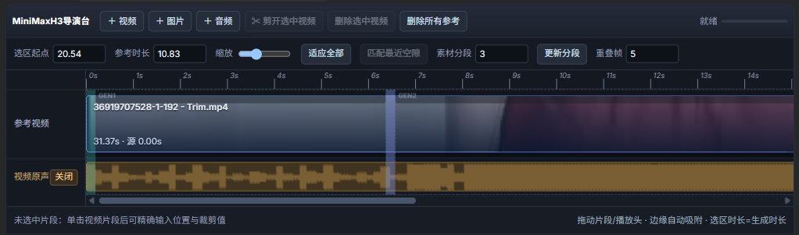
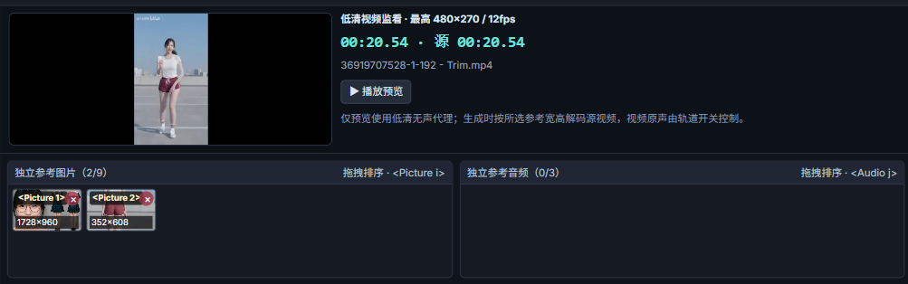
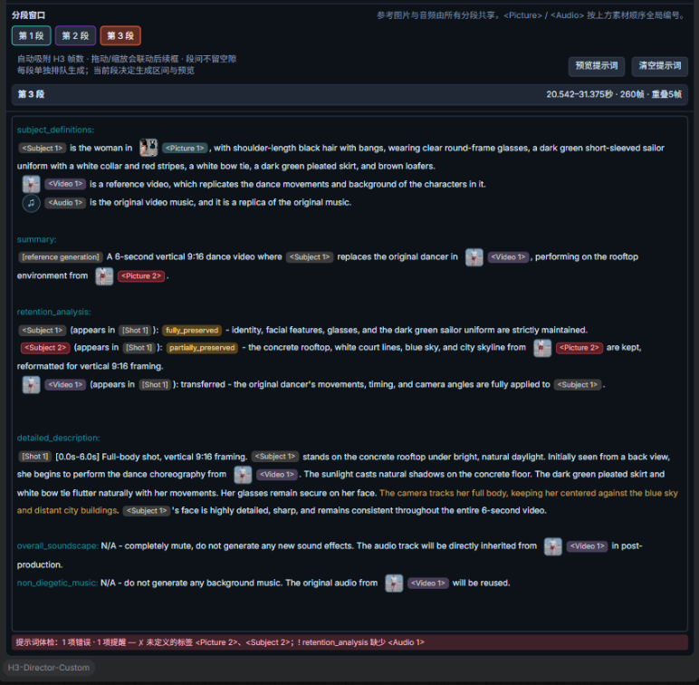

# MiniMaxH3 导演台

> **MiniMax H3 Director** — 一个面向 MiniMax H3 全量参考视频生成的单节点时间线导演台。
>
> 把参考视频、参考图片、参考音频、分段生成和提示词编排集中在**一个 ComfyUI 节点**里，直接输出 H3 采样器需要的 conditioning 与 latent。



---

## 目录

- [1. 简介与主要优势](#1-简介与主要优势)
- [2. 这个节点用来做什么](#2-这个节点用来做什么)
- [3. 功能详解](#3-功能详解)
  - [3.1 时间线与参考视频](#31-时间线与参考视频)
  - [3.2 素材库与低清预览](#32-素材库与低清预览)
  - [3.3 分段窗口与提示词](#33-分段窗口与提示词)
- [4. 安装与模型准备](#4-安装与模型准备)
- [5. 快速上手](#5-快速上手)
- [6. 参考素材规则与限制](#6-参考素材规则与限制)
- [7. 提示词与体检](#7-提示词与体检)
- [8. 常见问题](#8-常见问题)
- [9. 支持与赞赏](#9-支持与赞赏)
- [10. 许可与致谢](#10-许可与致谢)

---

## 1. 简介与主要优势

**MiniMaxH3 导演台**把原本需要多个节点、反复手动拼接的 H3 全量参考流程，收进了一个带时间线面板的节点里：

- 在时间线上放置参考视频、参考图片和参考音频；
- 选择要生成的区间或分段；
- 用可视化的 `<Picture N>` / `<Video N>` / `<Audio N>` 标签编写提示词；
- 节点内部加载 H3 文本编码器和 VAE，直接产出 `conditioning`、`latent` 和分段索引。

### 主要优势

- **单节点整合，轻量编排**
  - 不再需要单独的 Planner / Encoder / CLIPLoader / VAELoader 节点；
  - 一个节点完成参考素材规划、条件编码和 latent 构造；
  - 输出可以直接接入 H3 采样器，也把视频/音频 VAE 暴露给下游。

- **轻量前端，不拖慢 ComfyUI**
  - 面板使用原生 DOM 和 CSS，不做逐帧尺寸测量；
  - 时间线拖动、分段和提示词编辑都在节点内完成；
  - 预览使用低清无声代理，不参与正式生成。

- **按需消费，避免无谓开销**
  - 参考视频逐条解码、逐条编码，不会同时把多段高分辨率帧留在内存里；
  - 参考视频按 H3 参考画布上限解码，减少 1080p/4K 素材的无效解码；
  - **提示词预览**只调用轻量后端路由做文本规范化，不加载 CLIP/VAE，也不执行节点；
  - 参考素材超出 H3 上限时会提前提示，而不是等排队后才静默丢弃。

- **高效率的可视化工作流**
  - 时间线直接决定 `Video N` 的区间、顺序和引导帧；
  - `<Picture N>` / `<Video N>` / `<Audio N>` 编号由同一套规则生成，提示词 chip、片段角标、检查器和体检条保持一致；
  - 分段窗口、重叠帧、逐段排队都在面板内完成。

- **易用性**
  - 中英文界面；
  - 拖拽上传与拖拽排序；
  - 提示词富文本显示：媒体标签带缩略图，`[Shot]`、`<d>`、speaker、retention 标记有独立颜色；
  - 提示词体检条会指出缺少段落、未定义标签、未引用素材、时间码、素材上限等问题；
  - 一键预览实际送入编码器的提示词，支持复制。

> **关于“低消耗”的说明**：节点本身的编排和预览是轻量的，但 MiniMax H3 的文本编码器和 VAE 本身仍然需要显存/内存。真正生成时的主要资源消耗来自 H3 模型与采样器，本节点不会改变模型的固有开销。

---

## 2. 这个节点用来做什么

这个节点服务于 **MiniMax H3 全量参考（Full Reference / Ref2VA）视频生成**：

1. 把源视频放到参考视频轨道，设置使用区间、裁剪、参考尺寸和视频用途；
2. 添加参考图片和参考音频，并按需要排序；
3. 用青色生成选区或分段窗口决定本次生成的时间范围；
4. 按照 H3 提示词规范编写六段式 Prompt；
5. 节点内部完成：
   - 参考图片、参考视频、参考音频的读取与 VAE 编码；
   - `<Picture N>` / `<Video N>` / `<Audio N>` 参考顺序的组织；
   - 文本编码器推理；
   - 引导帧 / 边界帧挂载；
   - 空 AV latent 构造；
6. 输出给 H3 采样器。

### 节点输出

| 输出 | 用途 |
| --- | --- |
| `positive` | H3 conditioning（文本 + 参考素材） |
| `latent` | 目标视频/音频的空 AV latent |
| `video_vae` | 节点内加载的视频 VAE，可给下游解码 |
| `audio_vae` | 节点内加载的音频 VAE，可给下游解码 |
| `segment_index` | 当前选中的 1-based 分段序号 |

> `final_prompt` 输出已移除。需要查看最终送入编码器的提示词时，使用面板里的 **预览提示词** 按钮；它不会执行节点，也不会加载模型。

---

## 3. 功能详解

### 3.1 时间线与参考视频


- **顶部操作**
  - `＋ 视频` / `＋ 图片` / `＋ 音频`：上传素材；
  - `✂ 剪开选中视频`：在播放头处拆分当前参考片段；
  - `删除选中视频` / `删除所有参考`：清理素材。
- **时间线设置**
  - `选区起点` / `参考时长`：青色生成区域；
  - `缩放` / `适应全部`：时间线视图；
  - `匹配最近空隙`：把生成区域对齐到两个视频片段之间的空隙；
  - `素材分段` / `更新分段` / `重叠帧`：创建和管理多段生成窗口。
- **参考视频轨道**
  - 视频片段可以拖动、左右拉伸、修改源入点；
  - 片段角标显示实际会送入的 `<Video N>` 以及视频用途；
  - 超过 15 秒的交集会拆成多个参考窗口，最多取 3 段。
- **视频原声轨道**
  - 展示参考视频波形的可见区间；
  - `视频原声` 开关控制是否把原声作为 `<Audio N>` 参考；
  - 波形会随源入点、片段长度和切分正确显示。
- **生成区域**
  - 每个分段窗口使用独立颜色；当前段加粗高亮，其他段为虚线淡化；
  - 拖动或缩放当前段会联动后续窗口，自动吸附 H3 的 `5 + 17n` 帧网格。

#### 参考视频检查器

选中视频片段后，检查器提供：

- `起点`、`源入点`、`片段长度`；
- `视频用途`：
  - **固定 Guide**：把重叠区间作为逐帧固定引导；
  - **可编辑参考**：只作为 `<Video N>` 参考，不固定帧；
  - **仅固定边界**：只固定首尾边界帧；
- `参考宽 / 参考高`：参考视频解码画布；
- `源尺寸`：按源视频自身分辨率填入参考宽高；
- 原声音轨状态及实际 `<Audio N>` 编号。

### 3.2 素材库与低清预览



- **低清视频监看**
  - 最高 `480×270 / 12fps`，使用无声低清代理；
  - 显示时间线时间和源视频时间；
  - 支持播放/暂停；
  - 代理文件失效时会自动重新生成；
  - 生成阶段仍按所选参考尺寸解码原视频，预览画质不代表最终画质。
- **独立参考图片**
  - 最多 9 张；
  - 支持拖拽排序，标签为 `<Picture N>`；
  - 卡片直接显示**最终递交给编码器的尺寸**，会随参考图尺寸模式变化；
  - 支持删除。
- **参考图尺寸模式**
  - `match`：缩放到生成画布像素面积；
  - `average`：`match` 与 `max` 目标之间的中间值；
  - `max`：原图分辨率（短边超过 2048 才缩小）。
- **独立参考音频**
  - 最多 3 个；
  - 支持拖拽排序，标签为 `<Audio N>`；
  - 支持删除；
  - 音频编号遵循官方顺序：先列视频成对原声，再列独立音频；切换视频原声开关时独立音频编号会前后移动。

### 3.3 分段窗口与提示词



- **分段窗口**
  - 支持多段生成，每段独立排队；
  - 当前段决定生成区间和预览范围；
  - 段与段之间可设置重叠帧；
  - 点击“更新分段”时：
    - 新增分段 → 自动选中新增出来的第一段；
    - 减少分段 → 自动选中最后一段；
    - 数量不变 → 保持当前段；
  - 分段序号通过 `segment_index` 输出，方便路由和命名。
- **提示词编辑器**
  - 媒体标签会渲染成带缩略图的 chip：
    - `<Picture N>`、`<Video N>`、`<Audio N>`；
  - `<Subject N>`、`[Shot N]`、`[English]`、`(S1)`、`<d>`/`</d>`、`<scenetrans>`、`<cutoff>` 有独立颜色；
  - `retention_analysis` 里的 `fully_preserved` / `reference` / `fully_copy` 等固定标记会高亮；
  - 中英文、标签和标点间距会自动整理；
  - 保留用户输入的换行，不强制压行。
- **提示词工具**
  - `预览提示词`：调用后端规范化路由，弹窗显示**真正送入文本编码器的文本**，可复制；
  - `清空提示词`：载入起始模板，Ctrl+Z 可撤销。
- **提示词体检**
  - 检查六段结构、段落顺序、缺失/重复段落；
  - 检查未定义或超出素材数量的标签；
  - 检查已送入但没有被提示词引用的素材；
  - 检查 `[Shot 1]` 时间码、递增关系、超出生成时长；
  - 检查 retention 条目、`<d>` 使用位置等。
  - 截图中的体检条就是在提示未定义标签、缺少 retention 条目等问题。
- **编号规则**
  - 参考图片与音频由所有分段共享；
  - `<Picture N>` 按素材库顺序全局编号；
  - `<Video N>` 受当前生成区间和 15 秒窗口影响；
  - `<Audio N>` 采用官方顺序：先按视频顺序排列成对原声，再按素材库顺序排列独立音频；
  - 开启/关闭“视频原声”时，独立音频的编号会整体前后移动。

---

## 4. 安装与模型准备

### 前置条件

- 一个包含 MiniMax H3 原生节点的 ComfyUI 构建（例如包含 PR #15439 的构建）；
- 该构建需要提供 `MiniMaxH3AddGuide`（以及节点内部使用的 H3 参考编码接口）。若缺失，节点会给出明确错误提示。

### 安装

```bash
cd ComfyUI/custom_nodes
git clone <你的仓库地址> ComfyUI-H3-Director-Custom
```

重启 ComfyUI。

### 模型文件

节点会在内部加载以下模型，请在对应目录准备：

| 类型 | 目录 | 示例 |
| --- | --- | --- |
| H3 文本编码器 | `models/text_encoders` | `qwen3vl_32b_minimaxh3_nvfp4.safetensors` |
| 视频 VAE | `models/vae` | `minimax_h3_video_vae_int8_convrot.safetensors` |
| 音频 VAE | `models/vae` | `minimax_h3_audio_vae_fp32.safetensors` |

H3 扩散模型本身仍由工作流里的 UNETLoader 加载，不属于本节点。

### 示例工作流

建议随仓库提供一个 `example_workflow.json`。发布前请移除个人素材路径、文件名和预览代理路径，避免泄露本地信息。

---

## 5. 快速上手

1. 添加 **MiniMaxH3导演台** 节点；
2. 选择文本编码器、视频 VAE、音频 VAE（下拉框默认优先匹配 MiniMax H3 文件）；
3. 设置 `width` / `height`，或连接 `ResolutionSelector`；
4. 拖入参考视频/图片/音频：
   - 视频可裁剪、切分、设置视频用途和参考尺寸；
   - 图片可调整顺序，选择 `match` / `average` / `max`；
   - 音频可调整顺序；
5. 调整青色生成区域或分段窗口；
6. 编写六段式 H3 Prompt，使用 `<Picture N>` / `<Video N>` / `<Audio N>` 标签；
7. 点击 **预览提示词** 和查看体检条；
8. 将 `positive`、`latent`、`video_vae`、`audio_vae` 接入 H3 采样与解码流程；
9. 多段时逐段排队，使用 `segment_index` 标记/路由输出。

---

## 6. 参考素材规则与限制

| 项目 | 限制 |
| --- | --- |
| 参考图片 | 最多 9 张 |
| 参考视频窗口 | 最多 3 段；每段最多 15 秒 |
| 独立参考音频 | 最多 3 个 |
| 视频参考 | 只取与当前生成选区的交集 |
| 输出帧数 | 对齐 `5 + 17n`，上限 3592 帧 |
| 稳定生成区间 | H3 训练区间约 5–15 秒；更长不保证效果 |

补充说明：

- 视频交集超过 15 秒会拆成多个 `<Video N>`；每个带原声的窗口会各自对应一个 `<Audio N>`；
- 超出上限的素材不会被送入 H3，角标/体检条会提示；
- 参考图尺寸只影响图片参考；参考视频尺寸由片段的 `参考宽/高` 和 H3 参考画布共同决定；
- 预览代理是低清无声文件，最终生成会重新解码源素材。

---

## 7. 提示词与体检

完整的 H3 提示词建议遵循 `subject_definitions → summary → retention_analysis → detailed_description → overall_soundscape → non_diegetic_music` 的顺序。

编辑器会：

- 把 `<Picture N>` / `<Video N>` / `<Audio N>`、`[Shot N]`、`<d>` 等标记高亮；
- 清理标签/标点空格，同时保留你输入的换行；
- 在体检条中提示：
  - 缺少/重复/顺序错误的段落；
  - 未定义的参考标签；
  - 已送入但未在提示词中引用的素材；
  - 时间码或镜头编号问题；
  - 素材数量超出 H3 上限；
  - retention 条目和 `<d>` 使用位置问题。

> “预览提示词”显示的是清理后的提示词文本；`<Picture N>` 等参考条目会由 tokenizer 在提示词前自动插入，不会出现在这段文本里。

---

## 8. 常见问题

**Q：为什么预览画面是低清且没有声音？**
A：预览使用低清无声代理，目的是快速监看和拖动定位；生成时会按参考尺寸重新解码源素材。

**Q：为什么 `<Audio N>` 的编号会变？**
A：音频采用官方顺序：视频成对原声在前，独立音频在后。关闭/打开视频原声时，独立音频的编号会前后移动。以音频卡片、片段角标和检查器显示的编号为准。

**Q：为什么添加图片失败？**
A：请确认已重启 ComfyUI 并刷新页面。节点支持 PNG、JPEG、WebP 等常见图片；若媒体检查失败，ComfyUI 控制台会给出具体原因。

**Q：为什么节点比较吃显存？**
A：H3 的文本编码器、视频 VAE、音频 VAE 本身占用较大。节点会复用已加载的模型，但不会改变模型的固有显存需求。可以优先使用 `match` 参考图尺寸、缩短参考视频/音频和降低生成分辨率。

**Q：为什么 `final_prompt` 输出不见了？**
A：现在使用面板里的“预览提示词”查看最终文本；该预览不会执行节点或加载模型。

**Q：旧工作流里有“最终提示词”连线怎么办？**
A：旧版本的第 6 个输出已移除，请删除该 PreviewAny 节点或对应连线。

---

## 9. 支持与赞赏

如果这个节点对你的工作流有帮助，欢迎：

- ⭐ 给项目点一个 **Star**；
- 提交 Issue 反馈 bug 或使用问题；
- 提交 PR 改进代码、文案或工作流示例。

赞赏完全自愿，不影响任何功能，谢谢支持：


---

## 10. 许可与致谢

- 本项目依赖 ComfyUI 的 MiniMax H3 原生节点（包含 `MiniMaxH3AddGuide` 等接口）。
- 发布前请为仓库补充 `LICENSE` 文件；建议使用 MIT License。
- 截图和参考素材仅用于功能演示，请确认你拥有相应素材的公开/展示授权。

---

> 发布提示：请把 README 中引用的截图和赞赏码一并提交到仓库；如果使用 GitHub Pages/仓库根目录，建议移动到 `assets/` 并使用英文文件名。
